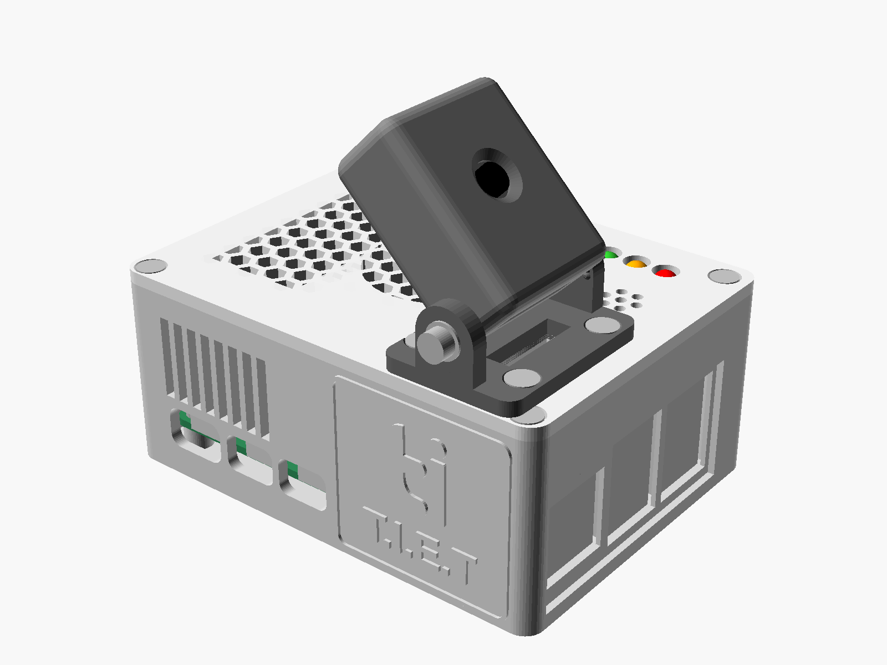

# SENTRIX enclosure, rev B

A 3D-printed case for the SENTRIX device: Raspberry Pi 5 with the Active
Cooler, Camera Module 3 in a separate tilting pod, a USB microphone and a
3-pin buzzer module. It stands on a table or hangs on a wall.

| File | What it is |
|---|---|
| `sentrix_enclosure.scad` | the parametric model (OpenSCAD 2021.01 or newer): every size is a named value at the top |
| `stl/` | one STL per part, already in print orientation: opens in every slicer |
| `3mf/` | the same parts as 3MF: Bambu Studio, PrusaSlicer, OrcaSlicer, Cura 5 |
| `renders/` | pictures of the assembly, the exploded view, the inside and the print plate |
| `build.py` | re-exports everything after a change; `--check` also runs the interference checks |

Every hole sits on the component's own hole, from Raspberry Pi Ltd's official
drawings: Raspberry Pi 5 (RP-008347), Active Cooler (RP-008188), Camera
Module 3 standard (RP-008153).

## The parts

| Part | Print orientation | Size (mm) | Supports |
|---|---|---|---|
| `sentrix_coupon` | flat | 74 x 30 x 18 | none - **print this first** (about 30 min) |
| `sentrix_base` | floor down | 97 x 73 x 39 | none |
| `sentrix_lid` | top face down (the SENTRIX lettering is on the bed) | 97 x 73 x 13 | none |
| `sentrix_bracket` | base plate down | 28 x 38 x 16 | none |
| `sentrix_pod` | lens face down | 33 x 30 x 15 | none |
| `sentrix_pod_back` | flat | 33 x 30 x 4 | none |

Every part fits a 120 x 120 mm bed, so any printer works (Ender 3, Prusa
MK3/MK4/Mini, Bambu A1/A1 mini/P1/X1, Anycubic, Creality K1 and so on).

## Print settings (any printer)

| Setting | Value |
|---|---|
| Material | **PETG** (best near the warm Pi) or PLA |
| Nozzle / layer height | 0.4 mm / 0.2 mm |
| Walls (perimeters) | 3; 4 for the bracket and the pod |
| Infill | 20 % gyroid (or grid) |
| Top / bottom layers | 4 / 4 |
| Supports | none |
| Brim | only if your PETG lifts at the corners |

**Fit coupon first.** It has a Pi standoff, a camera standoff, an M3 boss,
the buzzer cup, a USB-A window and the three board hole sizes. If a screw is
too tight or the buzzer will not go in, raise `tol` (holes, default 0.20) in
`sentrix_enclosure.scad`. If the buzzer is loose, lower `tol`. Then run
`python build.py`, or export from OpenSCAD: set `PART`, press F6, then File >
Export.

## Where each component goes

| Component | Placement |
|---|---|
| Raspberry Pi 5 | four standoffs on its M2.5 holes (58 x 49 mm grid), 5 mm above the floor |
| Active Cooler | stays clipped on the Pi. The lid has a hex intake over the blower (centre 42, 33.5 on the board) and a hex exhaust over the fins. The left end and the back have exhaust slots. |
| USB ports + Ethernet | the camera end of the case; the wall there is only 1 mm thick, so the USB microphone plugs in fully and faces outwards |
| USB-C power, 2 x micro-HDMI | the long front side, with openings large enough for the plug overmoulds |
| Power button | the end opposite the camera: press the round flexure in the wall. A nub inside pushes the Pi's button (18.4 mm from the USB-C edge). |
| Status LED | visible through the slot beside the power button |
| microSD card | slot under the power button, removable without opening the case |
| Buzzer (cylindrical, no screw holes) | pushed into a cup under the lid, held by three grip ribs; seven sound holes in the lid face the room |
| Camera Module 3 | inside the pod, on four standoffs on its M2 holes (21 x 12.5 mm grid); the lens sits 0.6 mm behind the window |
| Camera ribbon | leaves the case through a slot in the lid right under the pivot, then enters the pod through its floor right at the pivot, so tilting barely moves it |
| SENTRIX | engraved on the lid, and small on the pod's top |

## Screws and parts to buy

| Qty | Part | For |
|---|---|---|
| 4 | M2.5 x 6 mm | Raspberry Pi 5 to the standoffs |
| 4 | M2 x 6 mm | Camera Module 3 to the pod standoffs |
| 2 | M2 x 6 mm | pod back cover |
| 4 | M3 x 10 mm, pan head | lid to base |
| 4 | M3 x 8 mm, countersunk | bracket to lid |
| 2 | M3 x 8 mm + 2 washers | pod pivot (one each side) |
| 4 | rubber feet, 10 mm dia | table use (optional) |
| 2 | wall screws (shank 3.5-4 mm, head 6-8 mm) + plugs | wall use |

The screws cut their own thread in the plastic (pilot holes: M2 1.6, M2.5 2.1,
M3 2.5 mm). Brass heat-set inserts work too: set `pilot_m3 = 4.0` and
`pilot_m25 = 3.5`, then re-export.

A 200 mm Raspberry Pi 5 camera cable (22-pin to 15-pin) is long enough; the
path inside is about 100 mm.

## Assembly

1. **Pi into the base.** Fit the Active Cooler on the Pi and plug its fan
   cable into FAN. Insert the microSD card. Lower the Pi onto the standoffs,
   power button towards the flexure end, and screw it down (4 x M2.5 x 6).
2. **Camera ribbon.** Plug the 22-pin end into the Pi's CAM/DISP 0 connector.
   Thread the other end up through the slot in the lid, then through the
   bracket's slot.
3. **Bracket onto the lid** (4 x M3 x 8 countersunk), with the ribbon in its
   slot.
4. **Camera into the pod.** Thread the ribbon up through the pod's floor
   slot and plug it into the camera (contacts towards the board). Screw the
   camera onto the standoffs from the back (4 x M2 x 6), lens through the
   window. Close the back cover (2 x M2 x 6).
5. **Pod into the bracket.** Set it between the arms and put the two pivot
   screws in (M3 x 8 with washers). Tighten until the pod clicks firmly every
   15 degrees and holds its angle.
6. **Buzzer.** Wire the module to the GPIO: VCC to pin 2 (5 V), GND to pin 39,
   I/O to pin 37 (GPIO26). Push the round buzzer up into the cup under the lid
   until it seats.
7. **Close the case** (4 x M3 x 10 through the lid corners).
8. Plug the USB microphone into a USB port at the camera end, and the USB-C
   power cable into the long side.

## Camera angle

The pod tilts 0-90 degrees and clicks every 15 degrees. The scale is on the
pod's side, and the notch on the bracket arm points at the current angle.

* **On a table:** 0 degrees looks level along the table; 15-30 looks slightly
  up into the room.
* **On a wall:** hang it with the camera end down. 0 degrees looks straight
  down the wall and 90 straight out. **45 degrees** (the long tick) is the
  usual view from head height or above.

## Wall mounting

Two keyhole slots under the base, 42 mm apart along the case's length. Put
two screws in the wall one above the other, 42 mm apart, heads 2-3 mm proud.
Hang the case with the camera end down: the heads go into the round holes,
then slide the case down. The keyholes are closed on the inside, so no dust
or screw tip reaches the Pi.

## What was checked, and what was not

* An exact geometry check (`python build.py --check`) intersects each part
  with the space each component needs: the board, every port, the cooler,
  the GPIO header with DuPont plugs on it, the microSD card, the cooler's push
  pins, the button, the camera with its lens and connector, and the buzzer.
  It also checks the lid against the base, the back cover against the pod,
  and the pod against the bracket and lid at every 15 degrees of tilt. The
  click-detent bumps, which press 0.25 mm into the pod on purpose, are left
  out of the tilt check.
* **Not yet printed.** The buzzer cup assumes the standard 12 mm buzzer
  cylinder (9.5 mm tall); the coupon confirms the fit before the lid is
  printed. The USB microphone stays outside the case, so its body size does
  not matter.
