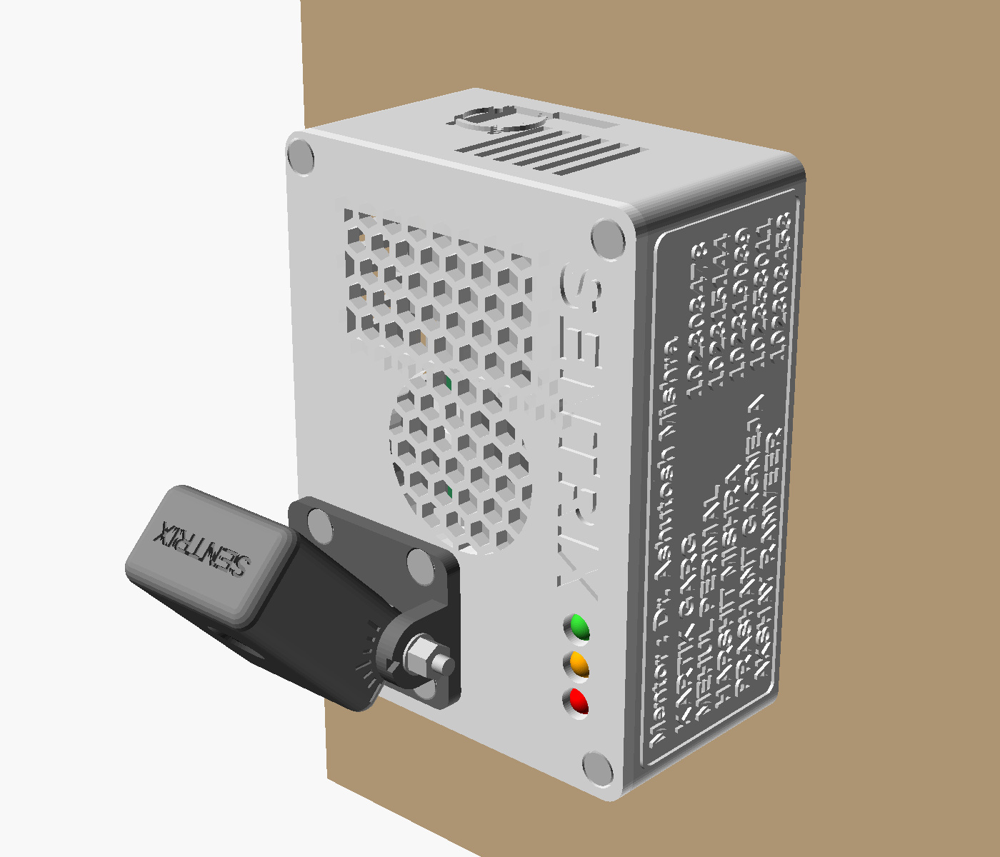

# SENTRIX enclosure, rev F

A 3D-printed case for the SENTRIX device: Raspberry Pi 5 with the Active
Cooler, Camera Module 3 in a separate tilting pod, a USB microphone and
three status LEDs. It hangs on a wall (the main configuration) or stands on
a table. There is no buzzer (D19, 2026-10-27), so rev F has no buzzer cup
and no sound holes in the lid.

| File | What it is |
|---|---|
| `sentrix_enclosure.scad` | the parametric model (OpenSCAD 2021.01 or newer): every size is a named value at the top |
| `stl/` | one STL per part, already in print orientation: opens in every slicer |
| `3mf/` | the same parts as 3MF: Bambu Studio, PrusaSlicer, OrcaSlicer, Cura 5 |
| `renders/` | pictures: assembled, exploded, on the wall, the inside and the print plate |
| `build.py` | re-exports everything after a change; `--check` also runs the interference checks |

Every hole sits on the component's own hole, from Raspberry Pi Ltd's official
drawings: Raspberry Pi 5 (RP-008347), Active Cooler (RP-008188), Camera
Module 3 standard (RP-008153).

**Revisions.** Rev B: the first checked design. Rev C: the three status LED
windows of the earlier rev A design (the device code drives green, orange
and red LEDs on GPIO 5, 12, 13); rev A's I/O bay, PIR window and speaker
grille are left out because this build has no relay, PIR or speaker.
Rev D: the pod turns on one M3 x 45 bolt with a nyloc nut (no thread in the
joint that moves); the wall keyholes on the case's centre line; longer screw
engagement and thicker lid-screw bosses; crush-rib seats that grip any
standard LED and buzzer. Rev E, after a check of every bought part against
its official drawing (each finding re-checked by an independent reviewer):

* **the camera is mounted connector-down.** Its picture is upright that way
  (the IMX708's device-tree rotation is 180 for a board held connector at the
  bottom, and libcamera's default undoes it; Raspberry Pi's own photo shows
  the ribbon leaving the bottom). Every earlier revision followed the drawing,
  which shows the board the other way up, and would have given an
  upside-down picture. The ribbon now drops straight out of the camera and
  through the pod's floor in front of the pivot bolt: no fold, no twist;
* the lens may sit up to 0.85 mm further forward than the drawing's 6.98 mm
  (the brief gives 11.5 +-0.2 mm overall), so the pod's front moved 0.65 mm
  and the lens stays at least 0.4 mm behind the window; the connector is
  2.75 mm deep;
* the side walls moved 0.3 mm out so the Pi drops in without scraping its USB
  tabs and micro-HDMI flares; the end-wall vents now face the cooler's fins;
  the lid's fin grille sits over the real fins; the cooler's real outline,
  open in front of the camera connectors, is modelled;
* the camera ribbon's path through the case, and a pocket for its spare
  length, are modelled and checked;
* the fit coupon also has the base's USB-C opening, and its pilot holes are
  as deep as the case's, so the real screws can be tried on it;
* after an independent review: the pod's cover screws sit in full-depth
  columns below the camera (they print upright, and the camera now slides
  straight onto its posts); the pivot bosses have a 45 degree keel so they
  print without support; the pod's floor slot sits 1 mm in front of the
  pivot bolt with its outer back edge rounded, so a taut ribbon never touches
  the bolt or a sharp corner; the keyholes take ordinary pan-head screws (3.2 mm head
  channel, 1.6 mm side walls, rounded slot ends); the back lid-screw bosses
  overlap the walls over their full height; the lid's grille ribs are the
  intended 1.4 mm;
* mesh clean-up, measured on the exported STLs: the base is one closed solid
  (the power button's ring had been a loose 9 mm3 piece touching the wall
  only along its edges, and the back lid-screw bosses left two sealed 5 mm3
  slivers against the rounded corners). No size or hole position changed;
  every STL now has every edge shared by exactly two faces;
* lettering on the base's long sides (below): the institute's mark and
  T.I.E.T on the front, the project team on the back. The back wall's seven
  exhaust slots moved to the front wall over the ports (eight 2.2 x 17 mm
  slots, the same open area), so the team's names have the whole back wall.

Rev F (2026-10-27): the device has no buzzer (D19), so the lid's buzzer cup,
its three crush ribs and the seven sound holes over it are gone, and so is the
coupon's buzzer cup. Nothing else moved: every other size and hole is rev E's.

## The parts

| Part | Print orientation | Size (mm) | PETG, solid | Supports |
|---|---|---|---|---|
| `sentrix_coupon` | flat | 92 x 30 x 18 | 14 g | none - **print this first** (about 30 min) |
| `sentrix_base` | floor down | 98 x 74 x 39 (with the lettering) | 57 g | none |
| `sentrix_lid` | top face down (the SENTRIX lettering is on the bed) | 97 x 73 x 13 | 23 g | none |
| `sentrix_bracket` | base plate down | 28 x 38 x 16 | 5 g | none |
| `sentrix_pod` | lens face down | 38 x 30 x 16 | 8 g | none |
| `sentrix_pod_back` | flat | 38 x 30 x 4 | 3 g | none |

Weights are for solid parts at 1.27 g/cm3; at 20 % infill and 3 walls expect
roughly half. Every part fits a 120 x 120 mm bed, so any printer works
(Ender 3, Prusa MK3/MK4/Mini, Bambu A1/A1 mini/P1/X1, Anycubic, Creality K1
and so on).

## Lettering

Both long sides of the base carry raised lettering, 0.6 mm proud, printed in
the case's own white and coloured by hand afterwards:

* **front** (the side with USB-C and HDMI), right of the ports: the Thapar
  Institute of Engineering and Technology "ti" mark (the institute's logo,
  traced from its flat version into `thapar_ti_mark.scad`) over **T.I.E.T**,
  in a rounded frame (39 x 36 mm);
* **back**: "Mentor : Dr. Ashutosh Mishra", then the five names on the left
  and their roll numbers on the right, 3.4 mm capitals, in a rounded frame
  (88 x 36 mm).

Raised rather than engraved, because the letters' 0.5 mm strokes print
cleanly standing proud of a vertical wall, while an engraved groove that
narrow closes up. Colour them with a fine paint marker (acrylic, 0.7 mm tip)
or a brush, wiping slips off the flat wall with a damp cloth; a light pass of
fine sandpaper over the letter tops first gives crisper edges. For the
sharpest letters print the base at 0.12-0.16 mm layers, and paint the seam
onto a corner (most slicers have a seam-painting tool) so it does not run
through a name.

The text is data at the top of `sentrix_enclosure.scad` (`mentor`, `team`), so
a name can be corrected there and the base re-exported; `lettering = false` leaves
both walls plain.

## Print settings (any printer)

| Setting | Value |
|---|---|
| Material | **PETG** (best near the warm Pi) or PLA |
| Nozzle / layer height | 0.4 mm / 0.2 mm |
| Walls (perimeters) | 3; 4 for the bracket and the pod |
| Infill | 20 % gyroid (or grid) |
| Top / bottom layers | 4 / 4 |
| Supports | none |
| Brim | only if your PETG lifts at the corners |

**Fit coupon first.** It has a Pi standoff, a camera post, an M3 boss (one
pilot of each size), an LED sleeve, a USB-A window, the
base's USB-C opening (the 27 W supply's plug body must slide through it) and
the three board hole sizes. Then adjust in `sentrix_enclosure.scad`:

| If | Change |
|---|---|
| a screw is too hard to drive or a boss splits | `pilot_adj` up by 0.1 |
| a screw strips | `pilot_adj` down by 0.1 |
| the LED is too hard to push in / loose | `led_grip` 4.9 / 4.7 (default 4.8) |
| holes and slots print small in general | `tol` up (default 0.20) |

Then run `python build.py`, or export from OpenSCAD: set `PART`, press F6,
then File > Export.

## Where each component goes

| Component | Placement |
|---|---|
| Raspberry Pi 5 | screwed down with 4 x M2.5 on four standoffs at its own holes (58 x 49 mm grid), 5 mm above the floor; the cooler clips into its own two holes |
| Active Cooler | hex intake in the lid right over the blower, hex exhaust over the fins, slots in the end wall and in the front wall over the ports |
| USB ports + Ethernet | the camera end of the case; the wall there is only 1 mm thick, so the USB microphone plugs in fully and faces outwards |
| USB-C power, 2 x micro-HDMI | three openings in the long side: USB-C 13.5 x 8.5 mm, each micro-HDMI 11.6 x 7.6 mm, sized for the plug bodies |
| Power button | the end opposite the camera: a round flexure in the wall with a 3 mm nub 0.3 mm from the Pi's button. Press once to switch on; while it runs, press twice for a clean shutdown; hold it to force the Pi off |
| Status LED (the Pi's own) | visible through the slot beside the power button |
| microSD card | a 13 x 3.8 mm slot under the power button: push the card in through it; pull it out with tweezers, or stick a small tape tab on the card |
| Status LEDs (3 x 5 mm) | pressed into sleeves under the lid from inside; three crush ribs narrow the 5.4 mm bore to 4.8 mm so any 5 mm LED is gripped; the LED's 5.6-6.0 mm rim stops on the sleeve and the dome sits flush |
| Camera Module 3 | bolted inside the pod with 4 x M2 into four posts on its own holes (21 x 12.5 mm grid), **connector at the bottom** (the way up its picture is upright); the lens sits at least 0.4 mm behind the window |
| Camera ribbon | straight down out of the camera's connector and through the pod's floor just in front of the pivot bolt (over a rounded edge), then through the bracket and lid slots; tilting the pod from 0 to 90 degrees draws 4.4 mm of it. In the case it rises from the Pi's CAM/DISP connector nearer the HDMI ports, crosses above the Ethernet jack, and its spare length lies in the pocket over the cooler's front plate (clear of both lid grilles) |
| Tilt pivot | one M3 x 45 bolt through both bracket arms and the pod, below the camera and behind the ribbon, with a nylon washer each side and a nyloc nut |
| SENTRIX | engraved on the lid, and small on the pod's top |

## Screws and parts to buy

| Qty | Part | For |
|---|---|---|
| 4 | M2.5 x 8 mm, pan head | Raspberry Pi 5 to the standoffs |
| 4 | M2 x 6 mm, pan head | Camera Module 3 to the pod's posts |
| 2 | M2 x 6 mm, pan head | pod back cover |
| 4 | M3 x 10 mm, pan head | lid to base |
| 4 | M3 x 10 mm, countersunk | bracket to lid |
| 1 | M3 x 45 mm bolt + M3 nyloc nut + 2 nylon washers | pod pivot |
| 3 | 5 mm LEDs (green, orange, red) + 330 ohm resistors | status lights |
| 1 | Raspberry Pi 5 camera cable, **200 mm** (official Standard-Mini; SC1128 / SC1892) | camera (the 500 mm one also works, see the assembly) |
| 2 | wall screws (shank 3.5-4 mm; pan or round head 6-8.4 mm across, up to 2.8 mm tall) + plugs | wall use |
| 4 | rubber feet, 10 mm dia | table use only |

## Screw grip

Every screw except the pivot bolt cuts its own thread into a pilot hole about
85 % of its size (M2 1.6, M2.5 2.1, M3 2.5 mm). Rule of thumb for printed
PETG: thread engaged at least 2 x the screw's diameter and a wall of 1.2 mm
or more round the hole.

| Joint | Screw | Thread engaged | Wall round the hole |
|---|---|---|---|
| Pi to base standoffs | M2.5 x 8 | 6.4 mm (2.6 x d) | 1.95 mm |
| Lid to base corners | M3 x 10 pan | 8.8 mm (2.9 x d) | 1.85-2.45 mm |
| Bracket to lid | M3 x 10 countersunk | 7.0 mm (2.3 x d) | 2.0 mm |
| Camera to pod posts | M2 x 6, from behind | 4.9 mm (2.4 x d) | 1.2 mm |
| Pod back cover | M2 x 6 | 4.6 mm (2.3 x d) | 1.4 mm |
| Pod pivot | M3 x 45 bolt + nyloc nut | none: smooth 3.6 mm holes | 5.9 mm of bearing each side |

The pivot is the one joint that moves, so it has no thread in the plastic:
the bolt turns in smooth holes, and the nyloc nut sets how stiff the tilt is
and never works loose. Brass heat-set inserts are not needed; the bosses are
sized for thread-forming screws.

## Assembly

1. **Camera ribbon into the Pi first.** Raspberry Pi advises plugging the
   ribbon in before fitting the Active Cooler (the connector is hard to reach
   after). Use the CAM/DISP connector nearer the HDMI ports, contacts towards
   the Ethernet jack. Then fit the Active Cooler and plug its fan cable into
   FAN, and insert the microSD card.
2. **Pi into the base.** Lower the Pi onto the standoffs, power button
   towards the flexure end, and screw it down (4 x M2.5 x 8). Lead the
   ribbon up beside the cooler, across above the Ethernet jack and up through
   the slot in the lid, then through the bracket's slot. The spare length
   goes in the pocket over the cooler's low front plate, between the
   micro-HDMI connectors and the fan, never over a lid grille: with the
   200 mm cable (~12 cm spare), a serpentine of three upright legs with bends
   no tighter than a pencil; with the 500 mm cable (~40 cm spare), fold it in
   half, roll it loosely around a pencil, tape it and stand it in the pocket.
   Arrange the spare with the pod tilted to 90 degrees, leaving at least 5 mm
   of free ribbon between the pocket and the lid slot: tilting from 0 to 90
   degrees draws 4.4 mm.
3. **Bracket onto the lid** (4 x M3 x 10 countersunk), with the ribbon in its
   slot.
4. **Camera into the pod.** Push the ribbon up through the slot in the pod's
   floor and plug it into the camera's connector (contacts towards the
   board). Slide the camera straight in from the back onto the four posts,
   **connector-down**, lens into the window, and screw it on from behind
   (4 x M2 x 6). Close the back cover (2 x M2 x 6, into the two columns below
   the camera).
5. **Pod into the bracket.** With the pod level (0 degrees) and the ribbon in
   its floor slot, push the M3 x 45 bolt through one arm, the pod and the
   other arm, with a nylon washer under the head and under the nut.
   Tighten the nyloc nut until the pod clicks firmly every 15 degrees and
   stays where you set it.
6. **LEDs.** Wire each LED's anode through a 330 ohm resistor: green to
   pin 29 (GPIO5), orange to pin 32 (GPIO12), red to pin 33 (GPIO13); all
   three cathodes to pin 34 (GND), or each to its own ground pin (30, 34,
   25). Press the LEDs into their sleeves from inside until their rims stop.

   The code drives the LEDs on its own: green solid when the unit works and
   the Portal link is up; orange fast blink on a fault, solid with no network;
   red slow blink at Level 3 or an open SOS, fast at Level 4, solid at Level 5.
7. **Close the case** (4 x M3 x 10 through the lid corners).
8. Hang it (below), then plug the USB microphone into a USB port at the
   bottom end and the USB-C power cable into the side.

## Wall mounting

Two keyhole slots under the base, 42 mm apart on the case's centre line.
Put two screws in the wall one above the other, 42 mm apart, and leave the
underside of each head 1.3-1.6 mm off the wall (about a coin's thickness):
the case's 1.2 mm lip slides behind the heads, and the 3.2 mm channel takes
a pan or round head up to 2.8 mm tall and 8.4 mm across. Hang the case with
the camera end down: the heads go into the round holes, then slide the case
down until the shanks reach the rounded ends of the slots. The keyholes are
closed on the inside (1.6 mm side walls, 0.8 mm roof), so no dust or screw
tip reaches the Pi. Leave the rubber feet off for the wall.

On the wall the lid faces the room: the cooler draws air through the lid
grille, warm air leaves through the slots in the top end, the USB microphone
points down from the bottom end and the USB-C cable leaves from the side.

## Camera angle

The pod tilts 0-90 degrees and clicks every 15 degrees. The scale is on the
pod's side, and the notch on the bracket arm points at the current angle.

* **On a wall:** 0 degrees looks straight down the wall and 90 straight out.
  **45 degrees** (the long tick) suits a unit above head height.
* **On a table:** 0 degrees looks level along the table; 15-30 looks slightly
  up into the room.

## What was checked, and what was not

* An exact geometry check (`python build.py --check`) intersects each part
  with the space each component needs: the board, every port, the cooler,
  the GPIO header with DuPont plugs on it, the microSD card, the cooler's push
  pins, the button, the camera connectors, the camera with its lens (at its
  deepest), connector and screw heads, and the LEDs with their
  legs. It also checks the ribbon's path inside the pod against the pod, the
  cover and the pivot bolt; the ribbon's path through the case and its spare
  length against the Pi, the base, the lid and the LEDs; the
  pivot bolt against the camera, the pod and the cover; the lid against the
  base; the back cover against the pod; and the pod against the bracket and
  lid at every 15 degrees of tilt. It also checks that the camera slides
  straight onto its posts from the open back, and that the wall screws sit
  in the keyholes. The click-detent bumps, which press 0.25 mm into the pod
  on purpose, are left out of the tilt check.
* **Not yet printed.** Print the coupon first: it shows whether the screws,
  an LED and the USB-C plug fit your printer before the big parts. Two
  things to measure: the USB microphone's metal plug must be at
  least 10.8 mm long to seat (a standard plug is 12 mm; its body stays
  outside), and the camera's lens tip should be no more than 7.83 mm in front
  of its board.

## The parts you bought, checked

| Part | Checked against | Result |
|---|---|---|
| Raspberry Pi 5, 8 GB | RP-008347 (one board for every RAM size) | holes, ports, button, microSD and LED line up; walls 0.3 mm clear of the USB tabs and HDMI flares |
| Official 27 W USB-C supply | product brief: plug body 12 x 7 mm | passes the 13.7 x 8.7 mm opening with 0.5 mm or more all round and seats fully |
| Official Active Cooler | RP-008188 | intake grille over the blower, exhaust grille over the fins, end-wall vents facing the fins |
| Camera Module 3, Robu SKU 1441079 (standard lens; the Wide would not fit the window) | RP-008153 and the Camera Module 2 drawing | board, holes, lens and connector exact to 0.001 mm; mounted connector-down for an upright picture; the window clears its 75 degree view |
| Camera cable, 500 mm | its path through the case | the path needs about 8 cm, so 500 mm leaves about 40 cm: it fits folded in half and rolled up in the pocket over the cooler's front plate. The 200 mm cable is neater |
| Scalebee USB mic | USB 2.0 plug dimensions | seats fully if its metal plug is at least 10.8 mm long |

The SENTRIX camera code needs nothing for this orientation. If a camera is
ever mounted connector-up, set `SENTRIX_PICAMERA_ROTATION=180` in the Pi's
`.env`: libcamera then flips the sensor's readout, at no cost.
